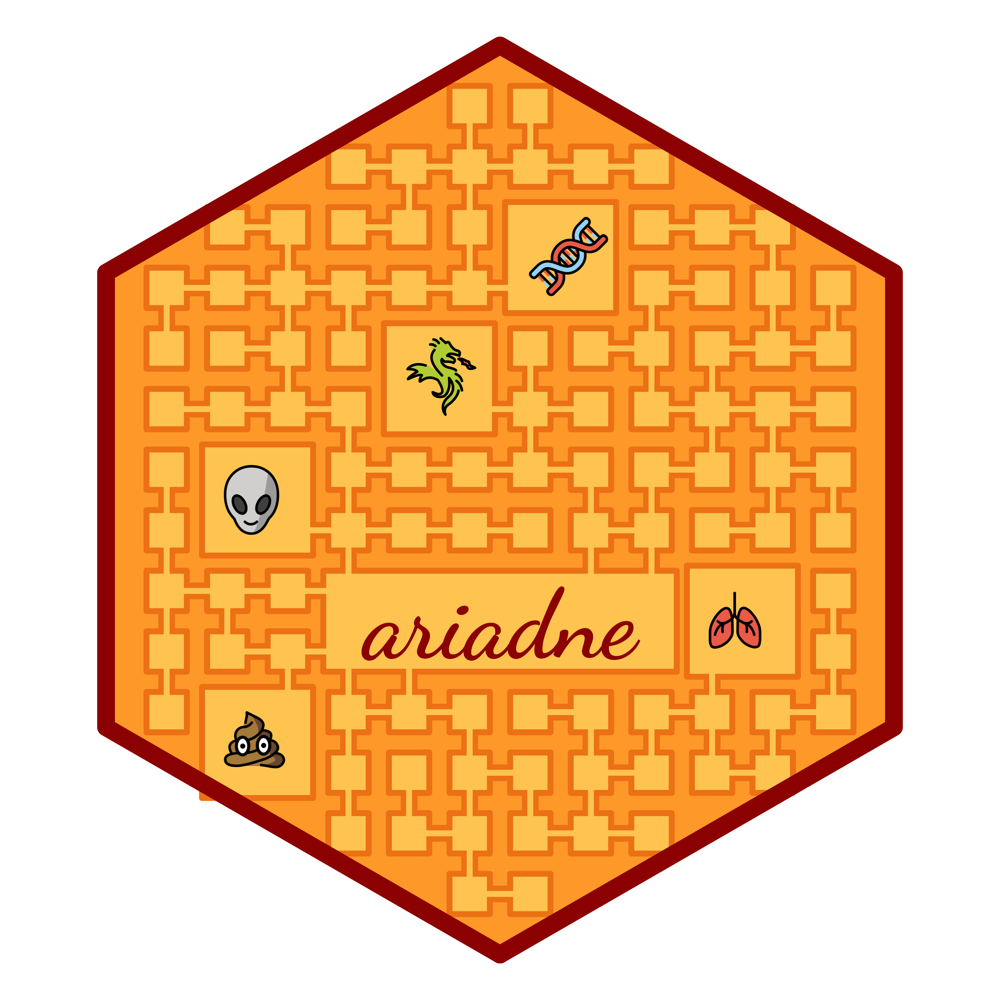

# ariadne: assembling relational information across the database network 

[](https://github.com/Minotau-R/ariadne/issues)
[](https://github.com/Minotau-R/ariadne/pulls)
[](https://github.com/Minotau-R/ariadne/actions)
[](https://codecov.io/gh/Minotau-R/ariadne)
[](https://www.codefactor.io/repository/github/minotau-r/ariadne)

ariadne is a multi-purpose R package that integrates relational knowledge from
various biological databases. It provides tools to navigate the resource graph,
find and visualise paths between features and link them across different omics
by leveraging the resource graph hosted in the companion package
[ariadneDB](https://github.com/Minotau-R/ariadneDB). It is also available in
Python with the package
[ariadnePy](https://github.com/Minotau-R/ariadnePy/tree/main) and as a web app
with the Shiny package [ariadneApp](https://github.com/Minotau-R/ariadneApp).

Example applications:

- Link across omics types based on prior knowledge (KEGG, UniProt, Rhea, etc.)
- Stratify microbial features by functional modules (BugSig, Gut Modules, etc.)
- Translate across different taxonomies (NCBI, SILVA, OTT, etc.)

## Installation instructions

The release version can be installed from Bioconductor with:

```
if (!requireNamespace("BiocManager", quietly = TRUE))
    install.packages("BiocManager")

BiocManager::install("ariadne")
```

To access the latest functionality, the development version can be installed
with:

```
if (!requireNamespace("BiocManager", quietly = TRUE))
    install.packages("BiocManager")

# Initialize Bioconductor devel version
BiocManager::install(version = "devel")

BiocManager::install("ariadne")
```

## Educational resources

To learn more about ariadne in theory and practice, it is recommended to consult
the following material:

- [(Poster) ariadne: enriching your 'omics analyses with prior knowledge from public databases](https://doi.org/10.5281/zenodo.20411835)
- [(Talk) Ariadne's thread: Navigating the maze of Biology (without getting lost)](https://doi.org/10.5281/zenodo.20596249)

## Terms of Use

While ariadne itself is openly available under an Artistic 2.0 license, the
resources included in the ariadne database come with their respective licenses
that must be carefully observed. Find more about the resources accessible via
ariadne in
[this vignette](https://minotau-r.github.io/ariadne/articles/resources.html).

## Code of Conduct

Please note that the ariadne project is released with a
[Contributor Code of Conduct](https://bioconductor.org/about/code-of-conduct/).
By contributing to this project, you agree to abide by its terms. Contributions
are welcome in the form of feedback, issues and pull requests. You can find our
contributor guidelines
[here](https://github.com/microbiome/mia/blob/devel/CONTRIBUTING.md).

## Acknowledgements

ariadne results from the joint effort of the larger Bioconductor community. In
particular, this software is related to the following packages:

- [_multifactor_](https://github.com/Minotau-R/multifactor/)
- [_mia_](https://doi.org/10.18129/B9.bioc.mia)
- [_anansi_](https://doi.org/10.18129/B9.bioc.anansi)
