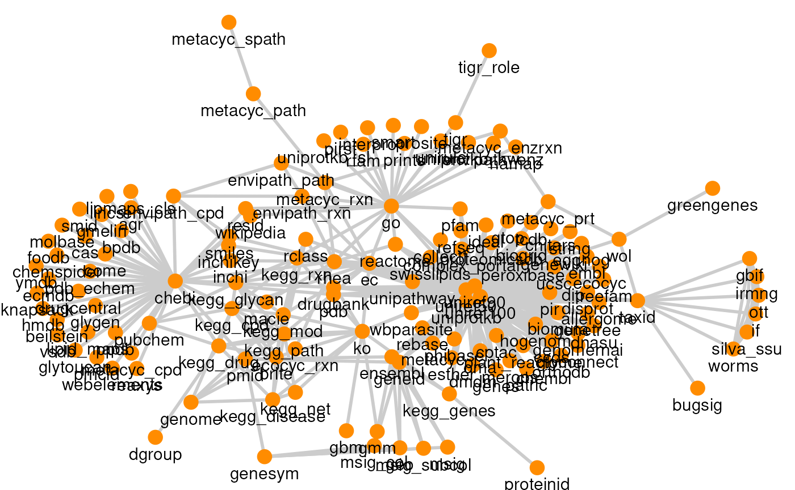
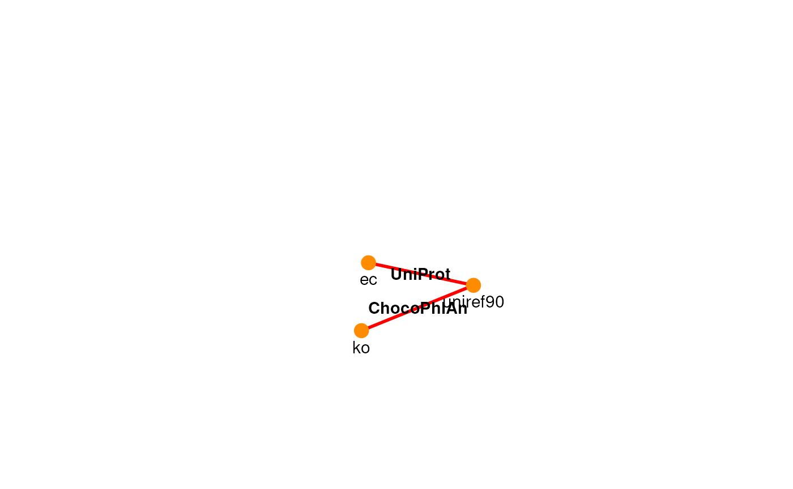
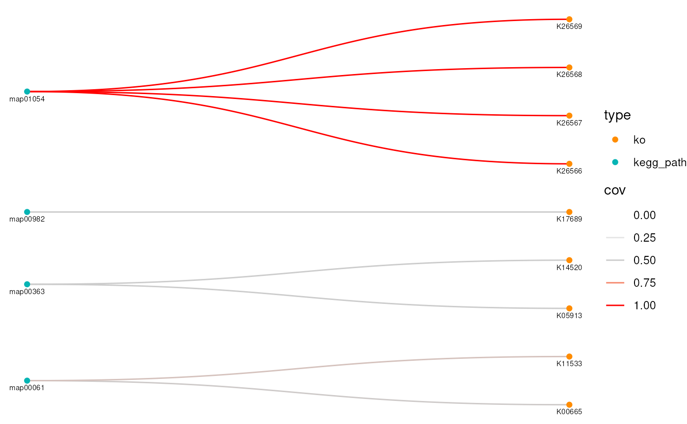
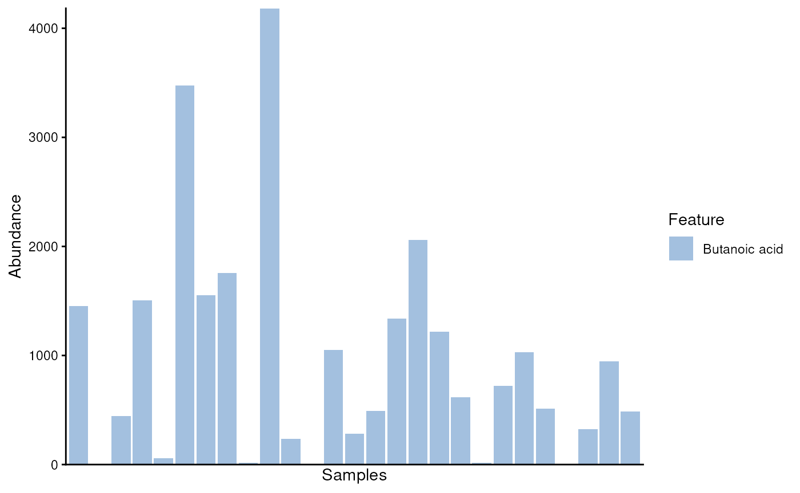
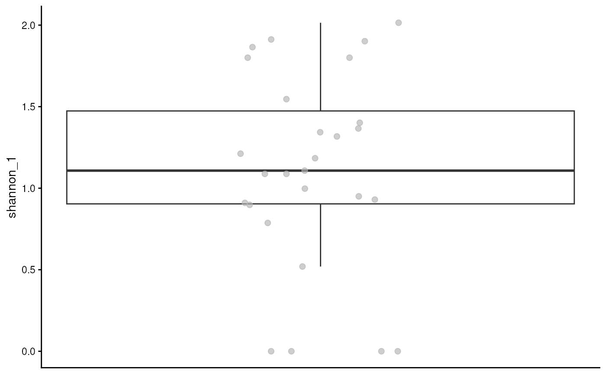

# ariadne: integrate prior knowledge in your bioinformatic analysis

## Motivation

Biological systems are inherently relational, governed by complex
interaction networks among genes, transcripts, proteins and organisms.
The systematic organisation of this relational metadata within public
repositories—such as UniProt (proteins), Rhea (reactions), and KEGG
(metabolic pathways)—provides a foundational framework for modern
computational biology. However, leveraging these resources in routine
bioinformatics workflows is frequently hindered by fragmented data
structures, heterogeneous file formats and data volumes that exceed
local computational capacities. Without a structured approach,
navigating the labyrinth of biological knowledge can feel overwhelming,
time-consuming and discouraging.

`ariadne` addresses these challenges by assembling a reproducible graph
of interlinked biological resources coupled with a robust programmatic
toolkit, which facilitates knowledge-driven annotation, feature
stratification and goal-oriented resource traversal. For example, it
enables functional annotation of microbial features via ChocoPhlAn and
the Web of Life (WoL), alongside feature aggregation using metabolic
modules and microbial signatures. By naturally extending to multi-omics
modalities (e.g., metabolites, proteins and genes), `ariadne` provides a
unified interface for integrating prior biological knowledge into
standard Bioconductor workflows (example use cases are presented in
[this
vignette](https://minotau-r.github.io/ariadne/articles/use_cases.html)).

## Tutorial

This tutorial demonstrates the programmatic usage of ariadne within
R/RStudio. For extensions in other environments, refer to
[ariadnePy](https://github.com/Minotau-R/ariadnePy) for Python and
[ariadneApp](https://github.com/Minotau-R/ariadneApp) for the Shiny app.

### Installation

The official Bioconductor release version can be installed as follows:

\
`if``(`` ``!`[`requireNamespace`](https://rdrr.io/r/base/ns-load.html)`(``"BiocManager"``, quietly ``=`` ``TRUE``)`` ``)``{`\
`    `[`install.packages`](https://rdrr.io/r/utils/install.packages.html)`(``"BiocManager"``)`\
`}`\
\
`BiocManager``::`[`install`](https://bioconductor.github.io/BiocManager/reference/install.html)`(``"ariadne"``)`

For the latest functionality, the devel version can be installed as
follows:

\
`if`` ``(``!`[`requireNamespace`](https://rdrr.io/r/base/ns-load.html)`(``"BiocManager"``, quietly ``=`` ``TRUE``)``)`\
`    `[`install.packages`](https://rdrr.io/r/utils/install.packages.html)`(``"BiocManager"``)`\
\
`# Initialise devel version`\
`BiocManager``::`[`install`](https://bioconductor.github.io/BiocManager/reference/install.html)`(``version ``=`` ``"devel"``)`\
\
`BiocManager``::`[`install`](https://bioconductor.github.io/BiocManager/reference/install.html)`(``"ariadne"``)`

### Import and explore the resource graph

`ariadne` combines various databases into a unified graph structure
providing links between biological entities. The mechanism of retrieving
and combining relational data is detailed in [this
vignette](https://minotau-r.github.io/ariadneDB/articles/ariadneDB.html).
In a nutshell, the companion data package `ariadneDB` defines feature
types and houses cross-database mappings formatted as graph objects that
are reproducibly hosted on Zenodo.

\
[`library`](https://rdrr.io/r/base/library.html)`(`[`ariadne`](https://codeberg.org/Minotau-R/ariadne)`)`\
[`library`](https://rdrr.io/r/base/library.html)`(`[`mia`](https://microbiome.github.io/mia/)`)`\
[`library`](https://rdrr.io/r/base/library.html)`(`[`miaViz`](https://github.com/microbiome/miaViz)`)`\
[`library`](https://rdrr.io/r/base/library.html)`(`[`igraph`](https://r.igraph.org/)`)`\
[`library`](https://rdrr.io/r/base/library.html)`(`[`ggplot2`](https://ggplot2.tidyverse.org)`)`\
[`library`](https://rdrr.io/r/base/library.html)`(`[`DT`](https://github.com/rstudio/DT)`)`

The resource graph is imported using the
[`ariadne()`](https://minotau-r.github.io/ariadne/reference/ariadne.md)
constructor, which returns the integrated database network as an igraph
object.

\
`# Import resource graph`\
`graph`` ``<-`` `[`ariadne`](https://minotau-r.github.io/ariadne/reference/ariadne.md)`(``)`

The graph topology can also be visualised using
[`plotPath()`](https://minotau-r.github.io/ariadne/reference/plotPath.md).

\
`# Plot resource graph`\
[`plotPath`](https://minotau-r.github.io/ariadne/reference/plotPath.md)`(``graph``)`\
`#> Using ``"stress"`` as default layout`

Suppose we need to trace relational paths between gene functions and
enzymatic activities represented by KEGG Orthologroups (KOs) and Enzyme
Commission (EC) numbers, respectively. The
[`searchPath()`](https://minotau-r.github.io/ariadne/reference/searchPath.md)
function identifies the $`k`$ shortest paths connecting these entities.

\
`# Search for paths from ko to ec`\
[`searchPath`](https://minotau-r.github.io/ariadne/reference/searchPath.md)`(``graph``, ``ko`` ``~`` ``ec``, k ``=`` ``3``)`\
`#> Path 1:`\
`#> ko -(KEGG)-> ec`\
`#> `\
`#> Path 2:`\
`#> ko -(ChocoPhlAn)-> uniref90 -(UniProt)-> ec`\
`#> `\
`#> Path 3:`\
`#> ko -(ChocoPhlAn)-> uniref50 -(UniProt)-> ec`

The top three paths include direct KO-EC mappings from KEGG as well as
indirect routes through UniRef50 and UniRef90 from ChocoPhlAn and
UniProt. Specific paths can be filtered and visualised using the
`include`, `exclude` and `res.name` arguments.

\
[`plotPath`](https://minotau-r.github.io/ariadne/reference/plotPath.md)`(``graph``, ``ko`` ``~`` ``ec``, include ``=`` ``"uniref90"``, prune ``=`` ``TRUE``)`\
`#> Using ``"stress"`` as default layout`

Because the output is a standard `igraph` object, native graph
operations are fully supported. For instance, we can evaluate node
centrality by sorting nodes according to their degree (total adjacent
edges):

\
`# Find and sort node degrees`\
`node_degrees`` ``<-`` ``graph`` ``|>`\
`    `[`degree`](https://r.igraph.org/reference/degree.html)`(``mode ``=`` ``"all"``)`` ``|>`\
`    `[`sort`](https://rdrr.io/r/base/sort.html)`(``decreasing ``=`` ``TRUE``)`` ``|>`\
`    `[`as.data.frame`](https://rdrr.io/r/base/as.data.frame.html)`(``)`\
\
`# Name degree variable`\
[`names`](https://rdrr.io/r/base/names.html)`(``node_degrees``)`` ``<-`` ``"degree"`\
\
`# View node degrees`\
[`datatable`](https://rdrr.io/pkg/DT/man/datatable.html)`(``node_degrees``)`

We can also compute local neighborhood sizes for specific feature types:

\
`# List neighbours of ko node`\
[`neighbors`](https://r.igraph.org/reference/neighbors.html)`(``graph``, ``"ko"``, mode ``=`` ``"all"``)`\
`#> + 14/147 vertices, named, from 5769202:`\
`#>  [1] brite        ec           gbm          gmm          kegg_disease`\
`#>  [6] kegg_drug    kegg_genes   kegg_mod     kegg_net     kegg_path   `\
`#> [11] kegg_rxn     rclass       uniref50     uniref90`

### Select and customise the resource graph

By default, `ariadne` uses the latest available resource releases.

\
`# List available resource versions`\
`versions`` ``<-`` `[`listResourceVersions`](https://minotau-r.github.io/ariadne/reference/listResourceVersions.md)`(``default ``=`` ``TRUE``)`\
\
`# View versions`\
[`datatable`](https://rdrr.io/pkg/DT/man/datatable.html)`(``versions``)`

However, historical or specific database releases can be pinned by
passing a named list to the `versions` argument.

\
`# List custom versions`\
`versions`` ``<-`` `[`list`](https://rdrr.io/r/base/list.html)`(``BugSigDB ``=`` ``"v1.2.2"``, WoL ``=`` ``"v20April2021"``)`\
\
`# Import graph with custom versions`\
`graph`` ``<-`` `[`ariadne`](https://minotau-r.github.io/ariadne/reference/ariadne.md)`(``versions ``=`` ``versions``)`

Custom resources (including local files) can be integrated into the
`ariadne` graph via
[`addResource()`](https://minotau-r.github.io/ariadne/reference/addResource.md).
For example, we can incorporate gene-to-antimicrobial resistance
mappings from the EMBL AMR Portal:

\
`# Set URL to custom resource`\
`url`` ``<-`` ``"https://ftp.ebi.ac.uk/pub/databases/amr_portal/releases/2025-12/"`\
`url`` ``<-`` `[`paste0`](https://rdrr.io/r/base/paste.html)`(``url``, ``"phenotype_genotype_merged.csv.gz"``)`\
\
`# Add resource to ariadne graph`\
`graph`` ``<-`` `[`addResource`](https://minotau-r.github.io/ariadne/reference/addResource.md)`(`\
`    ``graph``,`\
`    ``genesym`` ``~`` ``aro``,`\
`    ``url``,`\
`    res.name ``=`` ``"AMR"``,`\
`    select ``=`` `[`c`](https://rdrr.io/r/base/c.html)`(``"gene_symbol"``, ``"antibiotic_ontology"``)`\
`)`\
\
`# Search for newly added path`\
[`searchPath`](https://minotau-r.github.io/ariadne/reference/searchPath.md)`(``graph``, ``genesym`` ``~`` ``aro``)`\
`#> Path 1:`\
`#> genesym -(AMR)-> aro`

### Cross the graph to link biological entities

We decide to go through the simplest path, which corresponds to a `k`
of 1. The links between KO and EC are found by the function `weavePath`,
which fetches the necessary resources and weaves a path from ko to ec.

Selecting the most direct path ($`k = 1`$), we traverse the graph from
KO to EC using
[`weavePath()`](https://minotau-r.github.io/ariadne/reference/weavePath.md),
which dynamically fetches required backend resources and constructs the
mapping table.

\
`# Weave path from ko to ec`\
`ko2ec`` ``<-`` `[`weavePath`](https://minotau-r.github.io/ariadne/reference/weavePath.md)`(``graph``, ``ko`` ``~`` ``ec``, k ``=`` ``1``)`\
`#> ko -(KEGG)-> ec`\
`#> Warning: names for 1 ko ids not found.`\
`#> Warning: names for 3 ec ids not found.`

The output is returned as a `linkmap`—a tidy, two-column data frame
pairing source and target identifiers, optionally including feature name
annotations in a third column.

\
`# View some links`\
[`datatable`](https://rdrr.io/pkg/DT/man/datatable.html)`(``ko2ec``)`\
`#> Warning in instance$preRenderHook(instance): It seems your data is too big for`\
`#> client-side DataTables. You may consider server-side processing:`\
`#> https://rstudio.github.io/DT/server.html`

The weave can be initialised with a set of identifiers belonging to the
`from` id type. This is specified with the argument `init`.

\
`# Define custom ko initial values`\
`ko.ids`` ``<-`` `[`c`](https://rdrr.io/r/base/c.html)`(``"K00665"``, ``"K05913"``, ``"K11533"``)`\
\
`# Weave path with initial values`\
`ko2ec`` ``<-`` `[`weavePath`](https://minotau-r.github.io/ariadne/reference/weavePath.md)`(``graph``, ``ko`` ``~`` ``ec``, init ``=`` ``ko.ids``)`\
`#> ko -(KEGG)-> ec`\
\
`# View links`\
[`datatable`](https://rdrr.io/pkg/DT/man/datatable.html)`(``ko2ec``)`

Sometimes, we would like to know how much each origin id covers each
target id in terms of percent coverage (useful for pathway enrichment
analysis). This can be achieved with the alternative function
`weaveComplex`. For example, we can estimate the percentage of kegg
pathways covered by different ec ids, and select only those links above
a certain `threshold`.

When evaluating pathway enrichment or metabolic coverage, quantifying
source-to-target representation is essential. The
[`weaveComplex()`](https://minotau-r.github.io/ariadne/reference/weavePath.md)
function estimates feature coverage percentages and allows filtering
based on user-defined thresholds.

\
`# Find complex links between KO and KEGG pathways via reactions`\
`ko2path`` ``<-`` `[`weaveComplex`](https://minotau-r.github.io/ariadne/reference/weavePath.md)`(`\
`    ``graph``,`\
`    ``ko`` ``~`` ``kegg_path``,`\
`    threshold ``=`` ``0.5``,`\
`    include ``=`` ``"kegg_rxn"`\
`)`\
`#> ko -(KEGG)-> kegg_rxn`\
`#> kegg_rxn -(KEGG)-> kegg_path`\
\
`# View linkmap`\
[`datatable`](https://rdrr.io/pkg/DT/man/datatable.html)`(``ko2path``)`

The resulting mapping can be visualised with the
[`plotSets()`](https://minotau-r.github.io/ariadne/reference/plotSets.md)
function.

\
`# Visualise links`\
[`plotSets`](https://minotau-r.github.io/ariadne/reference/plotSets.md)`(``ko2path``, layout ``=`` ``"sugiyama"``)`` ``+`` `[`coord_flip`](https://ggplot2.tidyverse.org/reference/coord_flip.html)`(``)`

### Ensure reproducibility of the ariadne workflow

A path table is a metadata object that sufficiently describes the
parameters to reconstruct the complete `ariadne`workflow. The data
object `pathMeta` provides an example of this schema.

\
`# Import pathMeta object`\
[`data`](https://rdrr.io/r/utils/data.html)`(``"pathMeta"``, package ``=`` ``"ariadne"``)`\
\
`# View pathMeta object`\
[`datatable`](https://rdrr.io/pkg/DT/man/datatable.html)`(``pathMeta``)`

The
[`drawPath()`](https://minotau-r.github.io/ariadne/reference/drawPath.md)
function generates a corresponding path table for any valid traversal
query.

\
`# Draw path table from KO to KEGG pathways`\
`path_df`` ``<-`` `[`drawPath`](https://minotau-r.github.io/ariadne/reference/drawPath.md)`(`\
`    ``graph``,`\
`    ``ko`` ``~`` ``kegg_path``,`\
`    include ``=`` ``"kegg_rxn"`\
`)`\
\
`# View path table`\
[`datatable`](https://rdrr.io/pkg/DT/man/datatable.html)`(``path_df``)`

The resulting path table can be directly supplied to
[`weavePath()`](https://minotau-r.github.io/ariadne/reference/weavePath.md)
to reproduce the workflow.

\
`# Reproduce simple workflow from path table`\
`ko2ec.simple`` ``<-`` `[`weavePath`](https://minotau-r.github.io/ariadne/reference/weavePath.md)`(``path_df``)`\
`#> ko -(KEGG)-> kegg_rxn`\
`#> kegg_rxn -(KEGG)-> kegg_path`\
\
`# View linkmap`\
[`datatable`](https://rdrr.io/pkg/DT/man/datatable.html)`(``ko2ec.simple``)`\
`#> Warning in instance$preRenderHook(instance): It seems your data is too big for`\
`#> client-side DataTables. You may consider server-side processing:`\
`#> https://rstudio.github.io/DT/server.html`

Similarly, path tables are compatible with
[`weaveComplex()`](https://minotau-r.github.io/ariadne/reference/weavePath.md)
for coverage-based analyses.

\
`# Reproduce complex workflow from path table`\
`ko2ec.complex`` ``<-`` `[`weaveComplex`](https://minotau-r.github.io/ariadne/reference/weavePath.md)`(``path_df``)`\
`#> ko -(KEGG)-> kegg_rxn`\
`#> kegg_rxn -(KEGG)-> kegg_path`\
\
`# View linkmap`\
[`datatable`](https://rdrr.io/pkg/DT/man/datatable.html)`(``ko2ec.complex``)`\
`#> Warning in instance$preRenderHook(instance): It seems your data is too big for`\
`#> client-side DataTables. You may consider server-side processing:`\
`#> https://rstudio.github.io/DT/server.html`

### Add results to SummarizedExperiment for downstream analyses

ariadne natively integrates with the broader Bioconductor ecosystem,
supporting `SummarizedExperiment` (SE)-derived containers, the `mia`
ecosystem for microbiome data science and the `anansi` package for
knowledge-driven association analysis. We begin by loading the
`Tengeler2020` dataset.

\
`# Import experiment object`\
[`data`](https://rdrr.io/r/utils/data.html)`(``"Tengeler2020"``, package ``=`` ``"mia"``)`\
\
`# Rename experiment object`\
`tse`` ``<-`` ``Tengeler2020`\
\
`# View experiment object`\
`tse`\
`#> class: TreeSummarizedExperiment `\
`#> dim: 151 27 `\
`#> metadata(0):`\
`#> assays(1): counts`\
`#> rownames(151): Bacteroides Bacteroides_1 ... Parabacteroides_8`\
`#>   Unidentified_Lachnospiraceae_14`\
`#> rowData names(6): Kingdom Phylum ... Family Genus`\
`#> colnames(27): A110 A12 ... A35 A38`\
`#> colData names(4): patient_status cohort patient_status_vs_cohort`\
`#>   sample_name`\
`#> reducedDimNames(0):`\
`#> mainExpName: NULL`\
`#> altExpNames(0):`\
`#> rowLinks: a LinkDataFrame (151 rows)`\
`#> rowTree: 1 phylo tree(s) (151 leaves)`\
`#> colLinks: NULL`\
`#> colTree: NULL`

We also import the built-in `butyrate` linkmap, representing a typical
output generated by `ariadne` weave functions.

\
`# Import butyrate linkmap`\
[`data`](https://rdrr.io/r/utils/data.html)`(``"butyrate"``, package ``=`` ``"ariadne"``)`\
\
`# View butyrate linkmap`\
[`datatable`](https://rdrr.io/pkg/DT/man/datatable.html)`(``butyrate``)`

The
[`getSets()`](https://minotau-r.github.io/ariadne/reference/addSets.md)
function maps features to the specified annotation `keys` (such as Genus
or Family), returning a module membership matrix indicating
presence/absence or coverage fractions.

\
`# Get butyrate-producer set membership`\
`sets`` ``<-`` `[`getSets`](https://minotau-r.github.io/ariadne/reference/addSets.md)`(`\
`    ``tse``,`\
`    ``butyrate``,`\
`    key ``=`` `[`c`](https://rdrr.io/r/base/c.html)`(``"Genus"``, ``"Family"``)``,`\
`    names ``=`` ``TRUE`\
`)`\
\
`# View modules table`\
[`datatable`](https://rdrr.io/pkg/DT/man/datatable.html)`(``sets``)`

Using
[`addSets()`](https://minotau-r.github.io/ariadne/reference/addSets.md),
this module membership table is incorporated directly into the
experiment side information that can be accessed in downstream analyses.

\
`# Add modules to experiment as names instead of ids`\
`tse`` ``<-`` `[`addSets`](https://minotau-r.github.io/ariadne/reference/addSets.md)`(``tse``, ``butyrate``, key ``=`` ``"Genus"``, names ``=`` ``TRUE``)`

The `mia` package provides specialised methods for set-aware operations.
The
[`agglomerateByModule()`](https://microbiome.github.io/mia/reference/agglomerate-methods.html)
function aggregates assay abundance tables across features belonging to
specific sets.

\
`# Agglomerate features by membership to butyrate-producer set`\
`set.se`` ``<-`` `[`agglomerateByModule`](https://microbiome.github.io/mia/reference/agglomerate-methods.html)`(``tse``, by ``=`` ``"rows"``, group ``=`` ``"Butanoic acid"``)`\
\
`# Plot abundance of butyrate producers`\
[`plotAbundance`](https://rdrr.io/pkg/miaViz/man/plotAbundance.html)`(``set.se``)`\
`#> Warning: Removed 2 rows containing missing values or values outside the scale range`\
`` #> (`geom_bar()`). ``

Additionally,
[`applyByModule()`](https://microbiome.github.io/mia/reference/applyByModule.html)
enables arbitrary set-wise computations on an SE object. For example, it
is possible to estimate alpha diversity for each module (only one in
this case), which is sometimes called *functional diversity*.

\
`# Estimate alpha diversity for each module`\
`tse`` ``<-`` `[`applyByModule`](https://microbiome.github.io/mia/reference/applyByModule.html)`(`\
`    ``tse``,`\
`    .by ``=`` ``"rows"``,`\
`    .group ``=`` ``"Butanoic acid"``,`\
`    FUN ``=`` ``getAlpha``,`\
`    index ``=`` `[`c`](https://rdrr.io/r/base/c.html)`(``"shannon"``, ``"faith"``)``,`\
`    min.group.size ``=`` ``2`\
`)`\
\
`# viz functional alpha/beta`\
[`plotBoxplot`](https://rdrr.io/pkg/miaViz/man/plotBoxplot.html)`(``tse``, col.var ``=`` ``"shannon_1"``)`

## Resources

### Citation

We hope that ariadne will be useful for your research. Please use the
following information to cite the package and the overall approach.
Thank you!

\
`## Citation info`\
[`citation`](https://rdrr.io/r/utils/citation.html)`(``"ariadne"``)`\
`#> Warning in citation("ariadne"): could not determine year for 'ariadne' from`\
`#> package DESCRIPTION file`\
`#> To cite package 'ariadne' in publications use:`\
`#> `\
`#>   Benedetti G, Bastiaanssen T, Lahti L (????). _ariadne: Assembling`\
`#>   Relational Information Across the Database NEtwork_. R package`\
`#>   version 0.2.12, <https://codeberg.org/Minotau-R/ariadne>.`\
`#> `\
`#> A BibTeX entry for LaTeX users is`\
`#> `\
`#>   @Manual{,`\
`#>     title = {ariadne: Assembling Relational Information Across the Database NEtwork},`\
`#>     author = {Giulio Benedetti and Thomaz Bastiaanssen and Leo Lahti},`\
`#>     note = {R package version 0.2.12},`\
`#>     url = {https://codeberg.org/Minotau-R/ariadne},`\
`#>   }`

### Acknowledgements

ariadne originates from the joint effort of the R/Bioconductor
community. It is mainly based on the following software:

- [R](https://www.r-project.org/), statistical programming language (R
  Core Team 2025)
- [multifactor](https://github.com/Minotau-R/multifactor/), S7 classes
  for relational data (Bastiaanssen et al. 2023)

### Help

You can reach us by one of the communication channels listed
[here](https://microbiome.github.io/OMA/docs/devel/pages/support.html).
We are happy to receive questions, suggestions as well as contributions.
For the last point, check the [contributor
guidelines](https://microbiome.github.io/mia/CONTRIBUTING.html).

## Reproducibility

R session information:

    #> R version 4.6.1 (2026-06-24)
    #> Platform: x86_64-pc-linux-gnu
    #> Running under: Ubuntu 24.04.5 LTS
    #> 
    #> Matrix products: default
    #> BLAS:   /usr/lib/x86_64-linux-gnu/openblas-pthread/libblas.so.3 
    #> LAPACK: /usr/lib/x86_64-linux-gnu/openblas-pthread/libopenblasp-r0.3.26.so;  LAPACK version 3.12.0
    #> 
    #> locale:
    #>  [1] LC_CTYPE=en_US.UTF-8       LC_NUMERIC=C               LC_TIME=en_US.UTF-8        LC_COLLATE=en_US.UTF-8    
    #>  [5] LC_MONETARY=en_US.UTF-8    LC_MESSAGES=en_US.UTF-8    LC_PAPER=en_US.UTF-8       LC_NAME=C                 
    #>  [9] LC_ADDRESS=C               LC_TELEPHONE=C             LC_MEASUREMENT=en_US.UTF-8 LC_IDENTIFICATION=C       
    #> 
    #> time zone: UTC
    #> tzcode source: system (glibc)
    #> 
    #> attached base packages:
    #> [1] stats4    stats     graphics  grDevices utils     datasets  methods   base     
    #> 
    #> other attached packages:
    #>  [1] DT_0.34.0                       miaViz_1.21.7                   mia_1.21.14                    
    #>  [4] TreeSummarizedExperiment_2.21.0 Biostrings_2.81.9               XVector_0.53.0                 
    #>  [7] SingleCellExperiment_1.35.2     MultiAssayExperiment_1.39.1     SummarizedExperiment_1.43.0    
    #> [10] Biobase_2.73.2                  GenomicRanges_1.65.4            Seqinfo_1.3.2                  
    #> [13] IRanges_2.47.5                  S4Vectors_0.51.10               BiocGenerics_0.59.12           
    #> [16] generics_0.1.4                  MatrixGenerics_1.25.0           matrixStats_1.5.0              
    #> [19] ariadne_0.2.12                  igraph_2.3.4                    ggraph_2.2.2                   
    #> [22] ggplot2_4.0.3                   BiocStyle_2.41.0               
    #> 
    #> loaded via a namespace (and not attached):
    #>   [1] splines_4.6.1               ggplotify_0.1.4             filelock_1.0.3              R.oo_1.27.1                
    #>   [5] tibble_3.3.1                polyclip_1.10-7             XML_3.99-0.25               DirichletMultinomial_1.55.1
    #>   [9] lifecycle_1.0.5             httr2_1.3.0                 lattice_0.23-1              MASS_7.3-66                
    #>  [13] crosstalk_1.2.2             SnowballC_0.7.1             magrittr_2.0.5              sass_0.4.10                
    #>  [17] rmarkdown_2.32              jquerylib_0.1.4             yaml_2.3.12                 enviPathR_1.0.2            
    #>  [21] otel_0.2.0                  DBI_1.3.0                   RColorBrewer_1.1-3          abind_1.4-8                
    #>  [25] R.utils_2.13.0              purrr_1.2.2                 yulab.utils_0.2.5           tweenr_2.0.3               
    #>  [29] rappdirs_0.3.4              gdtools_0.5.2               ggrepel_0.9.8               tokenizers_0.3.0           
    #>  [33] irlba_2.4.1                 tidytree_0.4.8              rentrez_1.2.4               vegan_2.7-6                
    #>  [37] pkgdown_2.2.1               permute_0.9-10              DelayedMatrixStats_1.35.0   codetools_0.2-20           
    #>  [41] DelayedArray_0.39.8         scuttle_1.23.2              ggforce_0.5.0               tidyselect_1.2.1           
    #>  [45] aplot_0.3.2                 farver_2.1.2                ScaledMatrix_1.21.0         viridis_0.6.5              
    #>  [49] BiocFileCache_3.3.2         jsonlite_2.0.0              BiocNeighbors_2.7.3         decontam_1.33.0            
    #>  [53] tidygraph_1.3.1             scater_1.41.3               systemfonts_1.3.2           tools_4.6.1                
    #>  [57] ggnewscale_0.5.2            progress_1.2.3              treeio_1.37.1               ragg_1.5.2                 
    #>  [61] Rcpp_1.1.2                  glue_1.8.1                  gridExtra_2.3.1             SparseArray_1.13.4         
    #>  [65] multifactor_0.1.3           xfun_0.62                   mgcv_1.9-4                  dplyr_1.2.1                
    #>  [69] withr_3.0.3                 BiocManager_1.30.27         fastmap_1.2.0               bluster_1.23.1             
    #>  [73] digest_0.6.39               rsvd_1.0.6                  R6_2.6.1                    gridGraphics_0.5-1         
    #>  [77] textshaping_1.0.5           RSQLite_3.53.3              R.methodsS3_1.8.2           tidyr_1.3.2                
    #>  [81] fontLiberation_0.1.0        data.table_1.18.6.1         DECIPHER_3.9.3              prettyunits_1.2.0          
    #>  [85] graphlayouts_1.2.5          httr_1.4.9                  htmlwidgets_1.6.4           S4Arrays_1.13.2            
    #>  [89] pkgconfig_2.0.3             gtable_0.3.6                blob_1.3.0                  S7_0.2.2                   
    #>  [93] janeaustenr_1.0.0           htmltools_0.5.9             fontBitstreamVera_0.1.1     bookdown_0.48              
    #>  [97] scales_1.4.0                png_0.1-9                   ggfun_0.2.2                 knitr_1.52                 
    #> [101] tzdb_0.5.0                  reshape2_1.4.5              rncl_0.8.10                 nlme_3.1-171               
    #> [105] curl_8.1.0                  cachem_1.1.0                stringr_1.6.0               parallel_4.6.1             
    #> [109] vipor_0.4.7                 arrow_26.0.0                desc_1.4.3                  pillar_1.11.1              
    #> [113] grid_4.6.1                  vctrs_0.7.3                 BiocSingular_1.29.2         dbplyr_2.6.0               
    #> [117] beachmat_2.29.3             cluster_2.1.8.3             beeswarm_0.4.0              evaluate_1.0.5             
    #> [121] readr_2.2.0                 cli_3.6.6                   compiler_4.6.1              rlang_1.3.0                
    #> [125] crayon_1.5.3                tidytext_0.4.3              labeling_0.4.3              plyr_1.8.9                 
    #> [129] forcats_1.0.1               fs_2.1.0                    ggbeeswarm_0.7.3            ggiraph_0.9.6              
    #> [133] stringi_1.8.9               viridisLite_0.4.3           BiocParallel_1.47.0         assertthat_0.2.1           
    #> [137] lazyeval_0.2.3              fontquiver_0.2.1            Matrix_1.7-6                hms_1.1.4                  
    #> [141] patchwork_1.3.2             sparseMatrixStats_1.25.0    bit64_4.8.6                 KEGGREST_1.53.6            
    #> [145] memoise_2.0.1               bslib_0.12.0                rotl_3.1.1                  ggtree_4.3.0               
    #> [149] bit_4.6.0                   ape_5.8-1

Bastiaanssen, Thomaz F. S., Thomas P. Quinn, and John F. Cryan. 2023.
*Knowledge-Based Integration of Multi-Omic Datasets with Anansi:
Annotation-Based Analysis of Specific Interactions*.
<https://arxiv.org/abs/2305.10832>.

R Core Team. 2025. *R: A Language and Environment for Statistical
Computing*. R Foundation for Statistical Computing.
<https://www.R-project.org/>.
