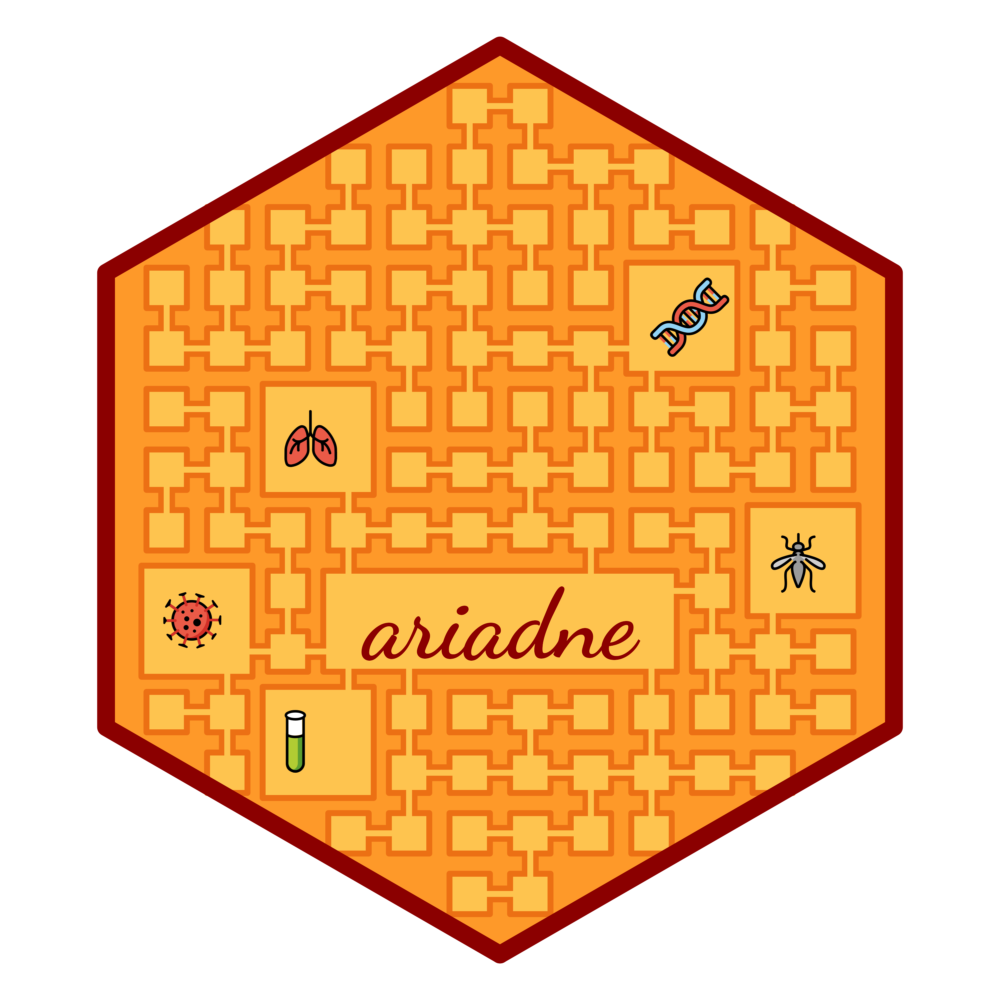

# ariadne logo: the Labyrinth of Biology

> If you’re going to decipher a hidden code from a complex set of
> different mazes, I’m pretty sure you need a girl’s brain running the
> show.
>
> ― James Dashner, *The Maze Runner*

Inspired by the legend of Theseus and the Minotaur, the ever-changing
(yet reproducible) ariadne logo reflects the variable nature of the
Labyrinth of Biology. The emojis found in the labyrinth rooms represent
isolated biological entities, which ariadne attempts to connect by
weaving a pathway between them.

Everything about the ariadne logo is reproducible and open source! A new
labyrinth configuration is generated every Wednesday by the [hexSticker
script](https://minotau-r.github.io/ariadne/articles/inst/scripts/make-hexSticker.R).
At the same time, new resource versions are automatically added to the
package metadata. Emojis are drawn from a selected subset of the
[OpenMoji Library](https://openmoji.org/) based on the calendar date
(Groß et al. 2018--2026). The text is styled with the Dancing Font as
provided by the [Font
Library](https://fontlibrary.org/font/dancing-font).

There is no single solution to the ariadne logo, but you have until next
Wednesday to find all connections between the feature emojis.

## References

Groß, Benedikt, Daniel Utz, and The OpenMoji Contributors. 2018--2026.
“OpenMoji.” <https://doi.org/10.5281/zenodo.19704720>.
