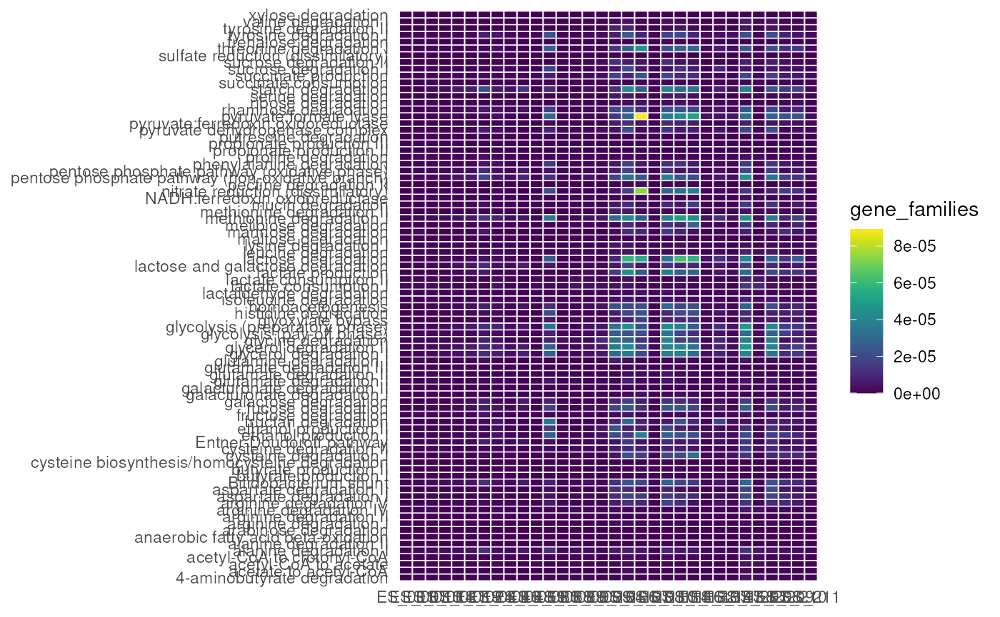
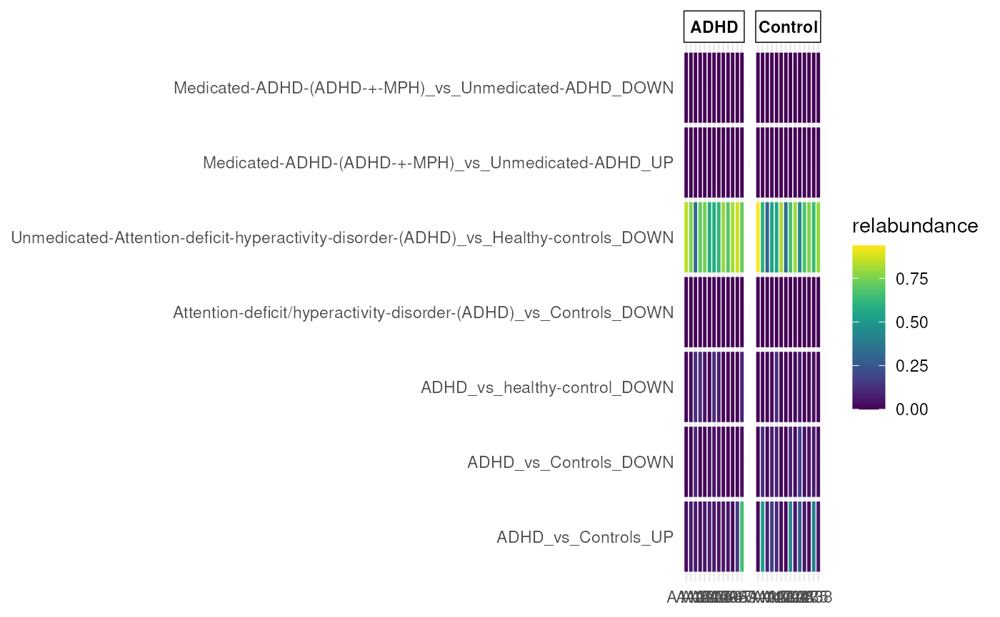

# ariadne in action: common use cases in omics research

`ariadne` integrates diverse biological resources spanning multiple
omics modalities, making it applicable to various omics data science
scenarios focused on enriching analyses with curated knowledge from
public databases. This tutorial demonstrates the following core
applications of `ariadne`:

| **Use case** | **Resources** | **Objective** |
|----|----|----|
| Functional annotation | ChocoPhlAn, WoL | Annotate microbial or gene features (UniRef) with sequence-based related functional information (e.g., KO, EC, and Pfam) |
| Taxonomic translation | OTT, UniProt | Convert taxonomic names and ids across taxonomies (NCBI, SILVA, OTT, etc.) |
| Set enrichment analysis | BugSigDB, GM, GO, MSigDB | Test for enriched or depleted functional sets of features between conditions |
| Pathway enrichment analysis | KEGG, Rhea, WoL | Test for enriched or depleted metabolic pathways linked to features between conditions |
| Knowledge-driven association analysis | KEGG, UniProt | Test previously reported associations between different omics layers (e.g., microbes, metabolites and genes) |

First, we load `ariadne` and additional libraries used across this
tutorial.

\
[`library`](https://rdrr.io/r/base/library.html)`(`[`ariadne`](https://codeberg.org/Minotau-R/ariadne)`)`\
[`library`](https://rdrr.io/r/base/library.html)`(`[`anansi`](https://github.com/thomazbastiaanssen/anansi)`)`\
[`library`](https://rdrr.io/r/base/library.html)`(`[`curatedMetagenomicData`](https://github.com/waldronlab/curatedMetagenomicData)`)`\
[`library`](https://rdrr.io/r/base/library.html)`(`[`mia`](https://microbiome.github.io/mia/)`)`\
[`library`](https://rdrr.io/r/base/library.html)`(`[`miaViz`](https://github.com/microbiome/miaViz)`)`\
[`library`](https://rdrr.io/r/base/library.html)`(`[`stringr`](https://stringr.tidyverse.org)`)`\
[`library`](https://rdrr.io/r/base/library.html)`(`[`DT`](https://github.com/rstudio/DT)`)`

We also import the `ariadne` resource graph that will be used to link
resources throughout this tutorial.

\
`# Import resource graph`\
`graph`` ``<-`` `[`ariadne`](https://minotau-r.github.io/ariadne/reference/ariadne.md)`(``)`

## Functional annotation

Resources such as ChocoPhlAn and Web of Life (WoL) have been developed
to annotate microbial features and gene families with relevant
functional information, including KEGG Orthogroups (KOs), Pfam domains,
enzyme commission (EC) numbers and Gene Ontology (GO). This allows to
derive actionable insight directly from biological assays.

Resources such as ChocoPhlAn and the Web of Life (WoL) annotate
microbial features and gene families with functional metadata—such as
KEGG Orthogroups (KOs), Pfam domains, Enzyme Commission (EC) numbers and
Gene Ontology (GO) terms—enabling the derivation of biological insights
directly from omics datasets.

We import and process the Castro-NallarE_2015 dataset from
[curatedMetagenomicData](https://doi.org/10.18129/B9.bioc.curatedMetagenomicData),
which entails 32 oral cavity microbiome samples from individuals with
Chron’s Disease, Type-2 Diabetes and schizophrenia.

We import and preprocess the `Castro-NallarE_2015` dataset from
[curatedMetagenomicData](https://doi.org/10.18129/B9.bioc.curatedMetagenomicData),
comprising 32 oral cavity microbiome samples from individuals with
Crohn’s disease, Type 2 diabetes and schizophrenia.

\
`# Load gene family experiment`\
`genes`` ``<-`` `[`curatedMetagenomicData`](https://rdrr.io/pkg/curatedMetagenomicData/man/curatedMetagenomicData.html)`(`\
`    ``"Castro-NallarE_2015.gene_families"``, dryrun ``=`` ``FALSE`\
`)`\
\
`# Extract experiment from list`\
`genes`` ``<-`` ``genes``[[``1``]``]`\
\
`# Keep only unstratified gene families`\
`genes`` ``<-`` ``genes``[`[`str_detect`](https://stringr.tidyverse.org/reference/str_detect.html)`(`[`rownames`](https://rdrr.io/r/base/colnames.html)`(``genes``)``, `[`fixed`](https://stringr.tidyverse.org/reference/modifiers.html)`(``"|"``)``, negate ``=`` ``TRUE``)``, ``]`\
\
`# View experiment`\
`genes`\
`#> class: SummarizedExperiment `\
`#> dim: 651411 32 `\
`#> metadata(0):`\
`#> assays(1): gene_families`\
`#> rownames(651411): UNMAPPED UniRef90_A0A1X3K551 ... UniRef90_A0A091MY75`\
`#>   UniRef90_A0A1I8JMV0`\
`#> rowData names(0):`\
`#> colnames(32): ES_001 ES_007 ... ES_210 ES_211`\
`#> colData names(21): study_name subject_id ... curator antibiotics_family`

We query the three shortest paths connecting UniRef90 gene families to
Gut Metabolic Modules (GMMs), selecting the primary path mediated by
ChocoPhlAn.

\
`# Search first three paths`\
[`searchPath`](https://minotau-r.github.io/ariadne/reference/searchPath.md)`(``graph``, ``uniref90`` ``~`` ``gmm``, k ``=`` ``3``)`\
`#> Path 1:`\
`#> uniref90 -(ChocoPhlAn)-> ko -(GM)-> gmm`\
`#> `\
`#> Path 2:`\
`#> uniref90 -(UniProt)-> ec -(KEGG)-> ko -(GM)-> gmm`\
`#> `\
`#> Path 3:`\
`#> uniref90 -(ChocoPhlAn)-> ec -(KEGG)-> ko -(GM)-> gmm`

For users familiar with the bioBakery suite, this operation corresponds
to `humann_regroup_table` from
[HUMAnN](https://github.com/biobakery/humann). However, ariadne
seamlessly concatenates preliminary and successive mapping steps to
directly link distinct feature spaces (e.g., microbes $`\rightarrow`$
UniRef $`\rightarrow`$ KOs $`\rightarrow`$ modules).

\
`# Weave bindings between taxa and GMMs`\
`uniref2gmm`` ``<-`` `[`weaveComplex`](https://minotau-r.github.io/ariadne/reference/weavePath.md)`(``graph``, ``uniref90`` ``~`` ``gmm``, init ``=`` `[`rownames`](https://rdrr.io/r/base/colnames.html)`(``genes``)``)`\
`#> uniref90 -(ChocoPhlAn)-> ko`\
`#> ko -(GM)-> gmm`\
\
`# View linkmap`\
[`datatable`](https://rdrr.io/pkg/DT/man/datatable.html)`(``uniref2gmm``)`

Alternatively, WoL can be utilized. Because UniRef-to-KO bindings are
exclusive to earlier releases, we explicitly import a previous version
of the resource graph.

\
`# Import past release of the resource graph`\
`graph.old`` ``<-`` `[`ariadne`](https://minotau-r.github.io/ariadne/reference/ariadne.md)`(``versions ``=`` `[`list`](https://rdrr.io/r/base/list.html)`(``WoL ``=`` ``"v20April2021"``)``)`\
\
`# Weave path through WoL`\
`uniref2gmm`` ``<-`` `[`weaveComplex`](https://minotau-r.github.io/ariadne/reference/weavePath.md)`(`\
`    ``graph.old``,`\
`    ``uniref90`` ``~`` ``gmm``,`\
`    init ``=`` `[`rownames`](https://rdrr.io/r/base/colnames.html)`(``genes``)``,`\
`    res.name ``=`` `[`c`](https://rdrr.io/r/base/c.html)`(``"WoL"``, ``"GM"``)`\
`)`\
`#> uniref90 -(WoL)-> ko`\
`#> ko -(GM)-> gmm`

Next, we incorporate these mappings into the experiment object and
agglomerate the features by set.

\
`# Add sets to experiment side information`\
`genes`` ``<-`` `[`addSets`](https://minotau-r.github.io/ariadne/reference/addSets.md)`(``genes``, ``uniref2gmm``, y.names ``=`` ``TRUE``)`\
\
`# Agglomerate experiment by set`\
`set.se`` ``<-`` `[`agglomerateByModule`](https://microbiome.github.io/mia/reference/agglomerate-methods.html)`(`\
`    ``genes``, by ``=`` ``"rows"``, group ``=`` `[`levels`](https://rdrr.io/r/base/levels.html)`(``uniref2gmm``$``gmm.name``)`\
`)`\
\
`# View experiment object`\
`set.se`\
`#> class: SummarizedExperiment `\
`#> dim: 84 32 `\
`#> metadata(0):`\
`#> assays(1): gene_families`\
`#> rownames(84): 4-aminobutyrate degradation acetate to acetyl-CoA ...`\
`#>   valine degradation I xylose degradation`\
`#> rowData names(0):`\
`#> colnames(32): ES_001 ES_007 ... ES_210 ES_211`\
`#> colData names(21): study_name subject_id ... curator antibiotics_family`

Finally, per-sample set abundances are visualised using a heatmap.

\
`# Visualise per-sample set abundances`\
[`plotHeatmap`](https://rdrr.io/pkg/miaViz/man/plotHeatmap.html)`(``set.se``, assay.type ``=`` ``"gene_families"``)`

## Taxonomic translation

Taxonomic harmonization and cross-referencing across nomenclature
systems are frequent bottlenecks in integrative multi-omics analyses.
ariadne facilitates robust ID translation and name resolution across
diverse taxonomies (e.g., NCBI, SILVA, OTT and Greengenes).

First, we load the built-in butyrate linkmap containing microbial
features associated with butyrate biosynthesis.

\
`# Import butyrate linkmap`\
[`data`](https://rdrr.io/r/utils/data.html)`(``"butyrate"``, package ``=`` ``"ariadne"``)`\
\
`# View butyrate linkmap`\
[`datatable`](https://rdrr.io/pkg/DT/man/datatable.html)`(``butyrate``)`

We map NCBI taxon identifiers to their corresponding binomial names.

\
`# Link taxon ids to names`\
`tax2name`` ``<-`` `[`linkNames`](https://minotau-r.github.io/ariadne/reference/linkNames.md)`(``graph``, ``"taxid"``, ids ``=`` ``butyrate``$``taxid``)`\
\
`# View linkmap`\
[`datatable`](https://rdrr.io/pkg/DT/man/datatable.html)`(``tax2name``)`

Conversely, NCBI taxon IDs can be retrieved from taxon names, which need
to be exact.

\
`# Link taxon names to ids`\
`name2tax`` ``<-`` `[`linkNames`](https://minotau-r.github.io/ariadne/reference/linkNames.md)`(``graph``, ``"taxid"``, names ``=`` ``butyrate``$``taxid.name``)`\
`#> Warning: ids for 1 taxid names not found.`\
\
`# View linkmap`\
[`datatable`](https://rdrr.io/pkg/DT/man/datatable.html)`(``name2tax``)`

Alternatively, we can query the Open Tree of Life Taxonomy (OTT) to
resolve taxon names using approximate string matching, accommodating
partial or imprecise entries.

\
`# Link taxon names to OTT ids`\
`name2ott`` ``<-`` `[`linkNames`](https://minotau-r.github.io/ariadne/reference/linkNames.md)`(``graph``, ``"ott"``, names ``=`` ``butyrate``$``taxid.name``)`\
\
`# Map OTT ids to NCBI taxon ids`\
`name2tax`` ``<-`` `[`weavePath`](https://minotau-r.github.io/ariadne/reference/weavePath.md)`(``graph``, ``ott.name`` ``~`` ``taxid``, init ``=`` `[`rev`](https://rdrr.io/r/base/rev.html)`(``name2ott``)``)`\
`#> ott stratified by ott.name`\
`#> ott -(OTT)-> taxid`\
\
`# View linkmap`\
[`datatable`](https://rdrr.io/pkg/DT/man/datatable.html)`(``name2tax``)`

OTT also bridges disparate taxonomies. Here, we translate NCBI taxon IDs
from the butyrate linkmap to corresponding SILVA SSU identifiers.

\
`# Convert taxid to silva`\
`tax2silva`` ``<-`` `[`weavePath`](https://minotau-r.github.io/ariadne/reference/weavePath.md)`(`\
`    ``graph``,`\
`    ``taxid`` ``~`` ``silva_ssu``,`\
`    init ``=`` ``butyrate``$``taxid``,`\
`    use.names ``=`` ``FALSE`\
`)`\
`#> taxid -(OTT)-> silva_ssu`\
\
`# View linkmap`\
[`datatable`](https://rdrr.io/pkg/DT/man/datatable.html)`(``tax2silva``)`

Similarly, WoL enables the translation of Greengenes identifiers to NCBI
taxon IDs.

\
`# Convert greengenes to taxid`\
`gg2tax`` ``<-`` `[`weavePath`](https://minotau-r.github.io/ariadne/reference/weavePath.md)`(``graph``, ``greengenes`` ``~`` ``taxid``)`\
`#> greengenes -(WoL)-> wol`\
`#> wol -(WoL)-> taxid`\
`#> Warning: names for 2 taxid ids not found.`\
\
`# View linkmap`\
[`datatable`](https://rdrr.io/pkg/DT/man/datatable.html)`(``gg2tax``)`

## Set enrichment analysis

Leveraging prior functional or phenotypic annotations, set enrichment
analysis tests whether predefined feature sets (genes, taxa, or
metabolites) are over- or under-represented. Common repositories include
GO or MSigDB for genes and BugSigDB for microbial signatures.

Feature sets of interest can be queried via keyword matching against
descriptive names. For instance, we extract attention deficit
hyperactivity disorder (ADHD)-related microbial signatures from BugSigDB
via the ariadne graph.

\
`# Retrieve all unique BugSig sets`\
`bugsig2name`` ``<-`` `[`linkNames`](https://minotau-r.github.io/ariadne/reference/linkNames.md)`(``graph``, ``"bugsig"``)`\
\
`# Extract sets related to ADHD`\
`adhd.sets`` ``<-`` ``bugsig2name``[`[`str_detect`](https://stringr.tidyverse.org/reference/str_detect.html)`(``bugsig2name``$``bugsig.name``, `[`fixed`](https://stringr.tidyverse.org/reference/modifiers.html)`(``"ADHD"``)``)``, ``]`\
\
`# View sets of interest`\
[`datatable`](https://rdrr.io/pkg/DT/man/datatable.html)`(``adhd.sets``)`

We load and preprocess the
[Tengeler2020](https://microbiome.github.io/mia/reference/Tengeler2020.html)
dataset, comprising stool metagenomic and metabolomic profiles from
humanised ADHD mice.

\
`# Import experiment object`\
[`data`](https://rdrr.io/r/utils/data.html)`(``"Tengeler2020"``, package ``=`` ``"mia"``)`\
\
`# Rename experiment object`\
`tse`` ``<-`` ``Tengeler2020`\
\
`# Transform counts to relative abundance`\
`tse`` ``<-`` `[`transformAssay`](https://microbiome.github.io/mia/reference/transformAssay.html)`(``tse``, method ``=`` ``"relabundance"``)`\
\
`# View experiment object`\
`tse`\
`#> class: TreeSummarizedExperiment `\
`#> dim: 151 27 `\
`#> metadata(0):`\
`#> assays(2): counts relabundance`\
`#> rownames(151): Bacteroides Bacteroides_1 ... Parabacteroides_8`\
`#>   Unidentified_Lachnospiraceae_14`\
`#> rowData names(6): Kingdom Phylum ... Family Genus`\
`#> colnames(27): A110 A12 ... A35 A38`\
`#> colData names(4): patient_status cohort patient_status_vs_cohort`\
`#>   sample_name`\
`#> reducedDimNames(0):`\
`#> mainExpName: NULL`\
`#> altExpNames(0):`\
`#> rowLinks: a LinkDataFrame (151 rows)`\
`#> rowTree: 1 phylo tree(s) (151 leaves)`\
`#> colLinks: NULL`\
`#> colTree: NULL`

We map microbial features at the genus level to their corresponding OTT
taxon IDs to establish initial values for graph traversal.

\
`# Link taxon names to OTT ids`\
`name2tax`` ``<-`` `[`linkNames`](https://minotau-r.github.io/ariadne/reference/linkNames.md)`(``graph``, ``"ott"``, names ``=`` `[`rowData`](https://rdrr.io/pkg/SummarizedExperiment/man/SummarizedExperiment-class.html)`(``tse``)``$``Genus``)`\
`#> Warning: ids for 40 ott names not found.`\
\
`# View linkmap`\
[`datatable`](https://rdrr.io/pkg/DT/man/datatable.html)`(``name2tax``)`

We weave a path from OTT taxon names to BugSig sets via OTT IDs,
yielding a linkmap directly compatible with our experiment object.

\
`# Weave path from OTT taxon names to bugsig`\
`tax2bugsig`` ``<-`` `[`weavePath`](https://minotau-r.github.io/ariadne/reference/weavePath.md)`(``graph``, ``ott.name`` ``~`` ``bugsig``, init ``=`` `[`rev`](https://rdrr.io/r/base/rev.html)`(``name2tax``)``)`\
`#> ott stratified by ott.name`\
`#> ott -(OTT)-> taxid`\
`#> taxid -(BugSigDB)-> bugsig`\
\
`# View linkmap`\
[`datatable`](https://rdrr.io/pkg/DT/man/datatable.html)`(``tax2bugsig``)`

This can be added to the experiment object and used to agglomerate the
assay by set, which returns the per-sample abundance for each set.

\
`# Add set information to experiment`\
`tse`` ``<-`` `[`addSets`](https://minotau-r.github.io/ariadne/reference/addSets.md)`(``tse``, ``tax2bugsig``, key ``=`` ``"Genus"``, y.names ``=`` ``TRUE``)`\
\
`# Limit sets to those found by weave (add support to agglomerateByModule)`\
`adhd.sets`` ``<-`` ``adhd.sets``[``adhd.sets``$``bugsig`` `[`%in%`](https://rdrr.io/r/base/match.html)` `[`levels`](https://rdrr.io/r/base/levels.html)`(``tax2bugsig``$``bugsig``)``, ``]`\
\
`# Agglomerate experiment by set`\
`adhd.se`` ``<-`` `[`agglomerateByModule`](https://microbiome.github.io/mia/reference/agglomerate-methods.html)`(``tse``, by ``=`` ``"rows"``, group ``=`` ``adhd.sets``$``bugsig.name``)`\
\
`# View results`\
`adhd.se`\
`#> class: TreeSummarizedExperiment `\
`#> dim: 7 27 `\
`#> metadata(0):`\
`#> assays(2): counts relabundance`\
`#> rownames(7): ADHD_vs_Controls_UP ADHD_vs_Controls_DOWN ...`\
`#>   Medicated-ADHD-(ADHD-+-MPH)_vs_Unmedicated-ADHD_UP`\
`#>   Medicated-ADHD-(ADHD-+-MPH)_vs_Unmedicated-ADHD_DOWN`\
`#> rowData names(0):`\
`#> colnames(27): A110 A12 ... A35 A38`\
`#> colData names(4): patient_status cohort patient_status_vs_cohort`\
`#>   sample_name`\
`#> reducedDimNames(0):`\
`#> mainExpName: NULL`\
`#> altExpNames(0):`\
`#> rowLinks: NULL`\
`#> rowTree: NULL`\
`#> colLinks: NULL`\
`#> colTree: NULL`

Finally, we visualise per-sample set abundances using a heatmap.

\
`# Visualise per-sample set abundance`\
[`plotHeatmap`](https://rdrr.io/pkg/miaViz/man/plotHeatmap.html)`(``adhd.se``, assay.type ``=`` ``"relabundance"``, col.var ``=`` ``"patient_status"``)`

## Pathway enrichment analysis

Analogous to set enrichment, pathway enrichment analysis tests for
enriched or depleted metabolic pathways based on feature coverage.
Representative resources include KEGG and MetaCyc for comprehensive
microbial metabolism, alongside specialised databases like enviPath for
xenobiotic biotransformation.

KEGG pathways can be mapped from KOs or ECs, ideally via KEGG reactions.

\
`# Search paths from ec to kegg pathways`\
[`searchPath`](https://minotau-r.github.io/ariadne/reference/searchPath.md)`(``graph``, ``ec`` ``~`` ``kegg_path``, include ``=`` ``"kegg_rxn"``, k ``=`` ``3``)`\
`#> Path 1:`\
`#> ec -(KEGG)-> kegg_rxn -(KEGG)-> kegg_path`\
`#> `\
`#> Path 2:`\
`#> ec -(KEGG)-> kegg_rxn -(KEGG)-> rclass -(KEGG)-> kegg_path`\
`#> `\
`#> Path 3:`\
`#> ec -(KEGG)-> kegg_glycan -(KEGG)-> kegg_rxn -(KEGG)-> kegg_path`

We link EC numbers to KEGG pathways while specifying a custom coverage
threshold.

\
`# Weave path from ec to kegg pathways`\
`ec2path`` ``<-`` `[`weaveComplex`](https://minotau-r.github.io/ariadne/reference/weavePath.md)`(`\
`    ``graph``,`\
`    ``ec`` ``~`` ``kegg_path``,`\
`    include ``=`` ``"kegg_rxn"``,`\
`    threshold ``=`` ``0.5`\
`)`\
`#> ec -(KEGG)-> kegg_rxn`\
`#> kegg_rxn -(KEGG)-> kegg_path`\
\
`# View linkmap`\
[`datatable`](https://rdrr.io/pkg/DT/man/datatable.html)`(``ec2path``)`

The MetaCyc pathways are provided by WoL2. However, they correspond to
an earlier version of MetaCyc before it became commercially available.

\
`# Search paths from ec to metacyc pathways`\
[`searchPath`](https://minotau-r.github.io/ariadne/reference/searchPath.md)`(``graph``, ``ec`` ``~`` ``metacyc_path``, k ``=`` ``3``)`\
`#> Path 1:`\
`#> ec -(WoL)-> metacyc_rxn -(WoL)-> metacyc_path`\
`#> `\
`#> Path 2:`\
`#> ec -(Rhea)-> rhea -(Rhea)-> metacyc_rxn -(WoL)-> metacyc_path`\
`#> `\
`#> Path 3:`\
`#> ec -(GO)-> go -(GO)-> metacyc_rxn -(WoL)-> metacyc_path`

Similarly, EC numbers are linked to associated MetaCyc pathways while
also estimating pathway coverage by feature.

\
`# Weave path from ec to metacyc pathways`\
`ec2path`` ``<-`` `[`weaveComplex`](https://minotau-r.github.io/ariadne/reference/weavePath.md)`(``graph``, ``ec`` ``~`` ``metacyc_path``)`\
`#> ec -(WoL)-> metacyc_rxn`\
`#> metacyc_rxn -(WoL)-> metacyc_path`\
`#> Warning: names for 1287 ec ids not found.`\
\
`# View linkmap`\
[`datatable`](https://rdrr.io/pkg/DT/man/datatable.html)`(``ec2path``)`\
`#> Warning in instance$preRenderHook(instance): It seems your data is too big for`\
`#> client-side DataTables. You may consider server-side processing:`\
`#> https://rstudio.github.io/DT/server.html`

## Knowledge-driven association analysis

[anansi](https://doi.org/10.18129/B9.bioc.anansi) evaluates pairwise
associations between dual-omics modalities (e.g., microbiome and
metabolome) within a unified experiment, restricting statistical
comparisons to prior biologically relevant or documented interactions.
ariadne supplies the necessary relational mappings to constrain this
search space.

We load the
[HintikkaXOData](https://microbiome.github.io/mia/reference/HintikkaXOData.html)
dataset, including stool metabolomic and metagenomic profiles from mice
subjected to low and high-fat dietary regimes.

\
`# Import dataset`\
[`data`](https://rdrr.io/r/utils/data.html)`(``"HintikkaXOData"``, package ``=`` ``"mia"``)`\
\
`# Rename object`\
`mae`` ``<-`` ``HintikkaXOData`\
\
`# View multi-assay experiment`\
`mae`\
`#> A MultiAssayExperiment object of 3 listed`\
`#>  experiments with user-defined names and respective classes.`\
`#>  Containing an ExperimentList class object of length 3:`\
`#>  [1] microbiota: TreeSummarizedExperiment with 12706 rows and 40 columns`\
`#>  [2] metabolites: TreeSummarizedExperiment with 38 rows and 40 columns`\
`#>  [3] biomarkers: TreeSummarizedExperiment with 39 rows and 40 columns`\
`#> Functionality:`\
`#>  experiments() - obtain the ExperimentList instance`\
`#>  colData() - the primary/phenotype DataFrame`\
`#>  sampleMap() - the sample coordination DataFrame`\
`` #>  `$`, `[`, `[[` - extract colData columns, subset, or experiment ``\
`#>  *Format() - convert into a long or wide DataFrame`\
`#>  assays() - convert ExperimentList to a SimpleList of matrices`\
`#>  exportClass() - save data to flat files`

We agglomerate the microbiome experiment by Genus and sanitise feature
names to maximise their successful conversion to OTT taxon ids.

\
`# Agglomerate microbiome experiment by Genus`\
`mae``[[``"microbiota"``]``]`` ``<-`` `[`agglomerateByRank`](https://microbiome.github.io/mia/reference/agglomerate-methods.html)`(``mae``[[``"microbiota"``]``]``, rank ``=`` ``"Genus"``)`\
`#> Duplicated labels were made unique.`\
\
`# Remove rank prefix from taxon names`\
[`rownames`](https://rdrr.io/r/base/colnames.html)`(``mae``[[``"microbiota"``]``]``)`` ``<-`` ``mae``[[``"microbiota"``]``]`` ``|>`\
`    `[`rownames`](https://rdrr.io/r/base/colnames.html)`(``)`` ``|>`\
`    `[`str_remove`](https://stringr.tidyverse.org/reference/str_remove.html)`(`[`fixed`](https://stringr.tidyverse.org/reference/modifiers.html)`(``"D_5__"``)``)`\
\
`# Link taxon names to OTT ids`\
`name2tax`` ``<-`` `[`linkNames`](https://minotau-r.github.io/ariadne/reference/linkNames.md)`(``graph``, ``"ott"``, names ``=`` `[`rownames`](https://rdrr.io/r/base/colnames.html)`(``mae``[[``"microbiota"``]``]``)``)`\
`#> Warning: ids for 70 ott names not found.`\
\
`# View linkmap`\
[`datatable`](https://rdrr.io/pkg/DT/man/datatable.html)`(``name2tax``)`

We map metabolite identifiers to corresponding KEGG compound IDs. In
practice, unmatched entries typically require manual curation.

\
`# Link metabolite names to KEGG compound ids`\
`name2cpd`` ``<-`` `[`linkNames`](https://minotau-r.github.io/ariadne/reference/linkNames.md)`(`\
`    ``graph``,`\
`    ``"kegg_cpd"``,`\
`    names ``=`` `[`rownames`](https://rdrr.io/r/base/colnames.html)`(``mae``[[``"metabolites"``]``]``)`\
`)`\
`#> Warning: ids for 9 kegg_cpd names not found.`\
\
`# View linkmap`\
[`datatable`](https://rdrr.io/pkg/DT/man/datatable.html)`(``name2cpd``)`

We then weave the path linking taxon names to KEGG compound IDs.

\
`# Weave path from taxon names to KEGG compound ids`\
`tax2cpd`` ``<-`` `[`weavePath`](https://minotau-r.github.io/ariadne/reference/weavePath.md)`(`\
`    ``graph``,`\
`    ``ott.name`` ``~`` ``kegg_cpd``,`\
`    init ``=`` `[`rev`](https://rdrr.io/r/base/rev.html)`(``name2tax``)``,`\
`    res.name ``=`` `[`c`](https://rdrr.io/r/base/c.html)`(``"OTT"``, ``"WoL"``, ``"KEGG"``)`\
`)`\
`#> ott stratified by ott.name`\
`#> ott -(OTT)-> taxid`\
`#> taxid -(WoL)-> wol`\
`#> wol -(WoL)-> metacyc_prt`\
`#> metacyc_prt -(WoL)-> metacyc_enzrxn`\
`#> metacyc_enzrxn -(WoL)-> metacyc_rxn`\
`#> metacyc_rxn -(WoL)-> ec`\
`#> ec -(KEGG)-> kegg_cpd`\
\
`# Remove KEGG compound id column`\
`tax2cpd``$``kegg_cpd`` ``<-`` ``NULL`\
\
`# Rename linkmap variables`\
[`names`](https://rdrr.io/r/base/names.html)`(``tax2cpd``)`` ``<-`` `[`c`](https://rdrr.io/r/base/c.html)`(``"microbiota"``, ``"metabolites"``)`\
\
`# Fix this behaviour in anansi`\
`tax2cpd`` ``<-`` ``tax2cpd``[``tax2cpd``$``microbiota`` `[`%in%`](https://rdrr.io/r/base/match.html)` `[`rownames`](https://rdrr.io/r/base/colnames.html)`(``mae``[[``"microbiota"``]``]``)``, ``]`\
`tax2cpd`` ``<-`` ``tax2cpd``[``tax2cpd``$``metabolites`` `[`%in%`](https://rdrr.io/r/base/match.html)` `[`rownames`](https://rdrr.io/r/base/colnames.html)`(``mae``[[``"metabolites"``]``]``)``, ``]`\
`tax2cpd``[``]`` ``<-`` `[`lapply`](https://rdrr.io/r/base/lapply.html)`(``tax2cpd``, ``factor``)`\
\
`# View linkmap`\
[`datatable`](https://rdrr.io/pkg/DT/man/datatable.html)`(``tax2cpd``)`

Finally, we construct an anansi Web object and execute the association
analysis.

\
`# Create anansi web object`\
`web`` ``<-`` `[`weaveWeb`](https://thomazbastiaanssen.github.io/anansi/reference/weaveWeb-generic.html)`(`\
`    ``mae``,`\
`    tableX ``=`` ``"microbiota"``,`\
`    tableY ``=`` ``"metabolites"``,`\
`    link ``=`` ``tax2cpd`\
`)`\
`#> Dropped features in tableX: 8 remain.`\
`#> Dropped features in tableY: 18 remain.`\
\
`# Perform association analysis`\
`out`` ``<-`` `[`anansi`](https://thomazbastiaanssen.github.io/anansi/reference/anansi.html)`(`\
`    web ``=`` ``web``,`\
`    formula ``=`` ``~`` ``Diet``,`\
`    adjust.method ``=`` ``"BH"`\
`)`\
`#> Fitting least-squares for following model:`\
`#> ~ x + Diet + x:Diet`\
`#> Warning in cor(x = web@tableY[group.bool, ], y = web@tableX[group.bool, : the`\
`#> standard deviation is zero`\
`#> Running correlations for the following groups:`\
`#>  High-fat, High-fat + XOS, Low-fat, Low-fat + XOS`\
`#> Warning in cor(x = web@tableY[group.bool, ], y = web@tableX[group.bool, : the`\
`#> standard deviation is zero`\
`#> Warning in cor(x = web@tableY[group.bool, ], y = web@tableX[group.bool, : the`\
`#> standard deviation is zero`\
`#> Warning in cor(x = web@tableY[group.bool, ], y = web@tableX[group.bool, : the`\
`#> standard deviation is zero`\
`#> Warning in cor(x = web@tableY[group.bool, ], y = web@tableX[group.bool, : the`\
`#> standard deviation is zero`\
\
`# Sort results by p-value`\
`out`` ``<-`` ``out``[`[`order`](https://rdrr.io/r/base/order.html)`(``out``$``full_p.values``)``, ``]`\
\
`# View results`\
[`datatable`](https://rdrr.io/pkg/DT/man/datatable.html)`(``out``)`

Resulting associations are visualised via a forest plot.

\
`# Fix this behaviour in anansi`\
`# Visualise associations`\
`# plotAnansi(`\
`#     out,`\
`#     association.type = "disjointed",`\
`#     model.var = "Diet"`\
`# )`

## Reproducibility

R session information:

    #> R version 4.6.1 (2026-06-24)
    #> Platform: x86_64-pc-linux-gnu
    #> Running under: Ubuntu 24.04.5 LTS
    #> 
    #> Matrix products: default
    #> BLAS:   /usr/lib/x86_64-linux-gnu/openblas-pthread/libblas.so.3 
    #> LAPACK: /usr/lib/x86_64-linux-gnu/openblas-pthread/libopenblasp-r0.3.26.so;  LAPACK version 3.12.0
    #> 
    #> locale:
    #>  [1] LC_CTYPE=en_US.UTF-8       LC_NUMERIC=C               LC_TIME=en_US.UTF-8        LC_COLLATE=en_US.UTF-8    
    #>  [5] LC_MONETARY=en_US.UTF-8    LC_MESSAGES=en_US.UTF-8    LC_PAPER=en_US.UTF-8       LC_NAME=C                 
    #>  [9] LC_ADDRESS=C               LC_TELEPHONE=C             LC_MEASUREMENT=en_US.UTF-8 LC_IDENTIFICATION=C       
    #> 
    #> time zone: UTC
    #> tzcode source: system (glibc)
    #> 
    #> attached base packages:
    #> [1] stats4    stats     graphics  grDevices utils     datasets  methods   base     
    #> 
    #> other attached packages:
    #>  [1] DT_0.34.0                       stringr_1.6.0                   miaViz_1.21.14                 
    #>  [4] mia_1.21.14                     MultiAssayExperiment_1.39.1     curatedMetagenomicData_3.21.3  
    #>  [7] TreeSummarizedExperiment_2.21.0 Biostrings_2.81.9               XVector_0.53.0                 
    #> [10] SingleCellExperiment_1.35.2     SummarizedExperiment_1.43.0     Biobase_2.73.2                 
    #> [13] GenomicRanges_1.65.4            Seqinfo_1.3.2                   IRanges_2.47.5                 
    #> [16] S4Vectors_0.51.10               BiocGenerics_0.59.13            generics_0.1.4                 
    #> [19] MatrixGenerics_1.25.0           matrixStats_1.5.0               anansi_1.3.0                   
    #> [22] ariadne_0.2.13                  igraph_2.3.4                    ggraph_2.2.2                   
    #> [25] ggplot2_4.0.3                   BiocStyle_2.41.0               
    #> 
    #> loaded via a namespace (and not attached):
    #>   [1] splines_4.6.1               ggplotify_0.1.4             filelock_1.0.3              tibble_3.3.1               
    #>   [5] polyclip_1.10-7             XML_3.99-0.25               DirichletMultinomial_1.55.1 lifecycle_1.0.5            
    #>   [9] httr2_1.3.0                 vroom_1.7.1                 lattice_0.23-1              MASS_7.3-66                
    #>  [13] crosstalk_1.2.2             SnowballC_0.7.1             magrittr_2.0.5              sass_0.4.10                
    #>  [17] rmarkdown_2.32              jquerylib_0.1.4             yaml_2.3.12                 enviPathR_1.0.2            
    #>  [21] otel_0.2.0                  DBI_1.3.0                   RColorBrewer_1.1-3          abind_1.4-8                
    #>  [25] purrr_1.2.2                 yulab.utils_0.2.5           tweenr_2.0.3                rappdirs_0.3.4             
    #>  [29] gdtools_0.5.2               ggrepel_0.9.8               tokenizers_0.3.0            irlba_2.4.1                
    #>  [33] tidytree_0.4.8              rentrez_1.2.4               vegan_2.7-6                 pkgdown_2.2.1              
    #>  [37] permute_0.9-10              DelayedMatrixStats_1.35.0   codetools_0.2-20            DelayedArray_0.39.8        
    #>  [41] scuttle_1.23.2              ggforce_0.5.0               tidyselect_1.2.1            aplot_0.3.2                
    #>  [45] farver_2.1.2                ScaledMatrix_1.21.0         viridis_0.6.5               BiocFileCache_3.3.3        
    #>  [49] jsonlite_2.0.0              BiocNeighbors_2.7.3         decontam_1.33.0             tidygraph_1.3.1            
    #>  [53] scater_1.41.3               systemfonts_1.3.2           tools_4.6.1                 ggnewscale_0.5.2           
    #>  [57] progress_1.2.3              treeio_1.37.1               ragg_1.5.2                  Rcpp_1.1.2                 
    #>  [61] glue_1.8.1                  gridExtra_2.3.1             SparseArray_1.13.4          BiocBaseUtils_1.15.1       
    #>  [65] multifactor_0.1.3           xfun_0.62                   mgcv_1.9-4                  dplyr_1.2.1                
    #>  [69] withr_3.0.3                 BiocManager_1.30.27         fastmap_1.2.0               bluster_1.23.1             
    #>  [73] digest_0.6.39               rsvd_1.0.6                  R6_2.6.1                    gridGraphics_0.5-1         
    #>  [77] textshaping_1.0.5           RSQLite_3.53.3              tidyr_1.3.2                 fontLiberation_0.1.0       
    #>  [81] data.table_1.18.6.1         DECIPHER_3.9.3              prettyunits_1.2.0           graphlayouts_1.2.5         
    #>  [85] httr_1.4.9                  htmlwidgets_1.6.4           S4Arrays_1.13.2             pkgconfig_2.0.3            
    #>  [89] gtable_0.3.6                blob_1.3.0                  S7_0.2.2                    janeaustenr_1.0.0          
    #>  [93] htmltools_0.5.9             fontBitstreamVera_0.1.1     bookdown_0.48               scales_1.4.0               
    #>  [97] png_0.1-9                   ggfun_0.2.2                 knitr_1.52                  tzdb_0.5.0                 
    #> [101] reshape2_1.4.5              rncl_0.8.10                 nlme_3.1-171                curl_8.1.0                 
    #> [105] cachem_1.1.0                BiocVersion_3.24.0          parallel_4.6.1              vipor_0.4.7                
    #> [109] arrow_26.0.0                AnnotationDbi_1.75.2        desc_1.4.3                  pillar_1.11.1              
    #> [113] grid_4.6.1                  vctrs_0.7.3                 BiocSingular_1.29.2         dbplyr_2.6.0               
    #> [117] beachmat_2.29.3             cluster_2.1.8.3             beeswarm_0.4.0              evaluate_1.0.5             
    #> [121] readr_2.2.0                 cli_3.6.6                   compiler_4.6.1              rlang_1.3.0                
    #> [125] crayon_1.5.3                tidytext_0.4.3              labeling_0.4.3              plyr_1.8.9                 
    #> [129] forcats_1.0.1               fs_2.1.0                    ggbeeswarm_0.7.3            ggiraph_0.9.6              
    #> [133] stringi_1.8.9               viridisLite_0.4.3           BiocParallel_1.47.0         assertthat_0.2.1           
    #> [137] lazyeval_0.2.3              fontquiver_0.2.1            Matrix_1.7-6                ExperimentHub_3.3.2        
    #> [141] hms_1.1.4                   patchwork_1.3.2             sparseMatrixStats_1.25.0    bit64_4.8.6                
    #> [145] KEGGREST_1.53.6             AnnotationHub_4.3.3         memoise_2.0.1               bslib_0.12.0               
    #> [149] rotl_3.1.1                  ggtree_4.3.0                bit_4.6.0                   ape_5.8-1
